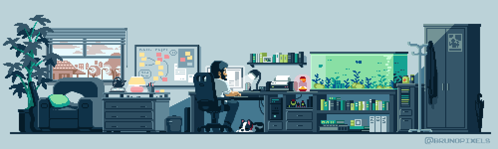
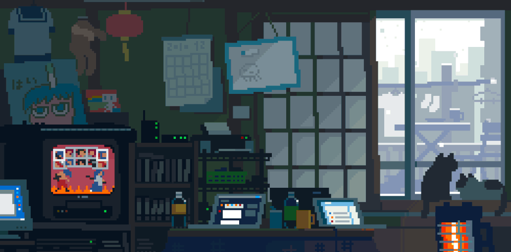
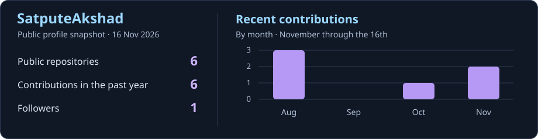

<p align="center">
  
</p>

<h1 align="center">Hi, I'm Akshad Satpute 👋</h1>

<p align="center">
  <b>BCA student from Pune, India</b> · building practical web apps and experimenting with game development
</p>

<p align="center">
  
  
  
  
</p>

## 🎯 About Me

<table>
<tr>
<td width="60%" valign="middle">

```js
const akshad = {
  location: "Pune, India",
  education: "BCA student",
  building: "Practical web apps",
  programming: ["C", "C++", "JavaScript"],
  exploring: ["Game development", "Unity", "Unreal Engine"]
};
```

I enjoy turning everyday workflows into web apps and experimenting with game development.

- 🔭 **Currently building:** web apps with React and Django
- 🌱 **Currently learning:** Unity and Unreal Engine
- 🧩 **Practicing:** problem solving on LeetCode and HackerRank
- 📫 **Reach me:** [Akshadsatpute@gmail.com](mailto:Akshadsatpute@gmail.com)

</td>
<td width="40%" align="center" valign="middle">
  
</td>
</tr>
</table>

## 🌐 Connect With Me

<p align="center">
  <a href="https://www.linkedin.com/in/akshad-satpute7"></a>
  <a href="https://www.instagram.com/isthat_akshad/"></a>
  <a href="https://leetcode.com/u/FRVovCQWDc/"></a>
  <a href="https://www.hackerrank.com/akshadsatpu46"></a>
  <a href="mailto:Akshadsatpute@gmail.com"></a>
</p>

## 🛠️ Tech Stack

### Languages and web development

<p>
  
  
  
  
  
  
  
  
  
  
</p>

### Databases and developer tools

<p>
  
  
  
  
  
  
  
  
  
  
</p>

### Games, mobile, and design

<p>
  
  
  
  
  
  
  
  
</p>

### Data and machine learning

<p>
  
  
  
  
  
  
</p>

## 📊 GitHub Analytics

<p align="center">
  <a href="https://github.com/SatputeAkshad#js-contribution-activity"></a>
</p>

## 🚀 Featured Work

### Developer Portfolio

A responsive React site that showcases my projects, technical skills, and development journey. I built it with React, JavaScript, HTML, and CSS.

[View portfolio](https://akshad-protfolio.vercel.app) · [Browse source code](https://github.com/SatputeAkshad/Akshad-protfolio)
